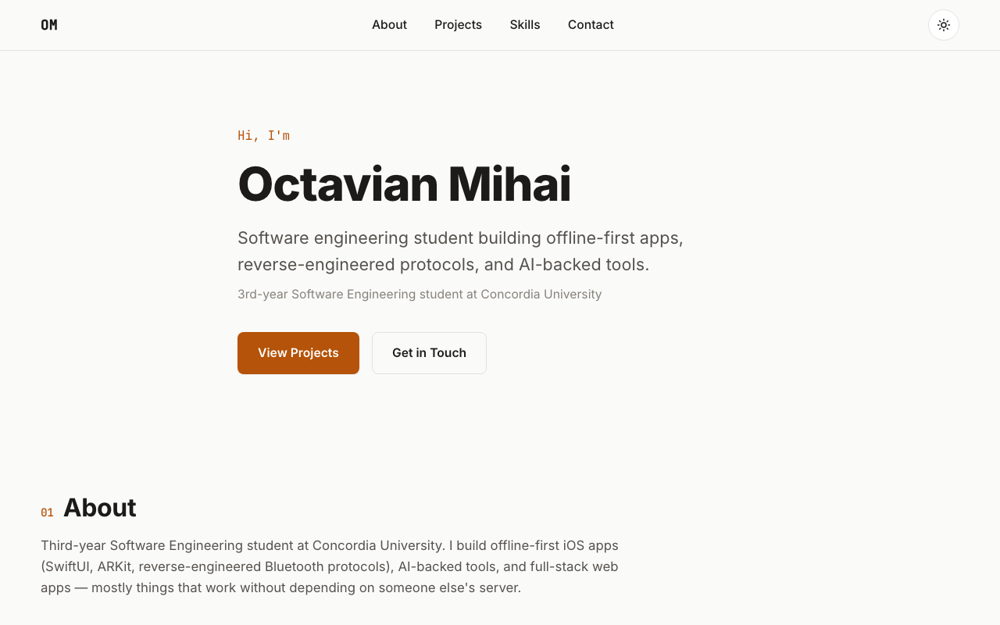
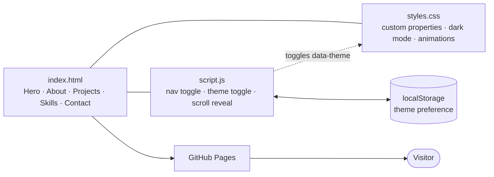

# Octavian Mihai — Portfolio

A single-page portfolio site built with plain HTML, CSS, and JavaScript — no frameworks, no build step.

**Live site:** https://octavian-mihai.github.io/personal-portfolio/

## Screenshots

## Architecture

More detail: [docs/ARCHITECTURE.md](docs/ARCHITECTURE.md)

## Features

- Mobile-first, semantic HTML with ARIA labels and full keyboard navigation
- Dark mode that follows system preference, with a manual toggle persisted via `localStorage`
- Respects `prefers-reduced-motion` — animations disable automatically
- WCAG AA color contrast, 16px+ body text, 1.6 line-height, ~70ch max reading width
- Sections: Hero, About, Projects, Skills, Contact

## Tech stack

Vanilla HTML5, CSS3 (custom properties, `color-mix`, Grid/Flexbox), and vanilla JavaScript (no dependencies).

## Project structure

| Path | Purpose |
|---|---|
| `index.html` | Markup and content: Hero, About, Projects, Skills, Contact |
| `styles.css` | Theming with custom properties, layout, dark mode, animations |
| `script.js` | Nav toggle, theme toggle (persisted), scroll reveal |
| `assets/` | Images and static files |
| `docs/` | `ARCHITECTURE.md` and screenshots |

## Design patterns

- **Design tokens as CSS custom properties.** Light values live in `:root` and dark values in overrides, so restyling means
  changing a variable such as `--accent`.
- **Progressive enhancement.** The page is complete semantic HTML; JavaScript only adds the nav toggle, theme toggle and reveals.
- **System preference first, user override second.** Theme follows `prefers-color-scheme` until the visitor picks one, which is
  stored in `localStorage` and applied through a `data-theme` attribute.
- **Accessibility as a default.** `prefers-reduced-motion` disables animation, and contrast, ARIA labels and keyboard navigation
  are part of the base design.
- **No dependencies, no build.** Plain files that any static host can serve.

## Customization

- **Content**: edit the text directly in `index.html` — the Hero tagline/bio are in the `#hero` and `#about` sections; project cards are `<article class="card">` blocks in `#projects`.
- **Colors**: all theming lives in CSS custom properties at the top of `styles.css` (`:root` for light mode, the dark-mode blocks below it). Change `--accent` to restyle the accent color everywhere.
- **Fonts**: Inter (body) and JetBrains Mono (labels/tech tags), loaded from Google Fonts via `<link>` tags in the `<head>`.
